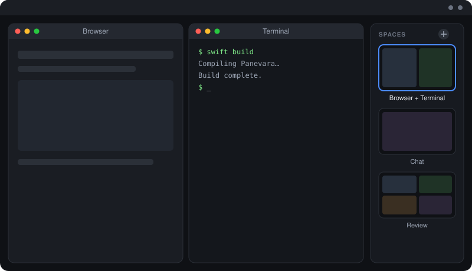

# Panevara

**One calm workspace for all your other Mac apps.**

Panevara arranges the real windows of your running apps into grids you design, and lets you switch between whole arrangements with one click. A strip of live previews floats at the edge of your screen; each preview is a **space**: a named grid of windows. Click a space and its windows slide into place. Click another and they swap. Your apps stay real, native and fully interactive: every click, keystroke, menu and drag works exactly as it does outside Panevara.

> Illustration, not a screenshot.

## Why not tiles inside one window?

macOS has no public way to embed another app's window inside yours. Apps that mirror windows as video lose real mouse and keyboard input, and many apps stop drawing when they aren't visible. Panevara takes the other route: it moves and resizes the **real** windows, so nothing is emulated and interaction has no lag. A small floating strip and a dark backdrop are the only things Panevara draws itself.

## What it does

- **Spaces:** each tile in the strip is a space with its own name and its own grid. Layouts: single pane, two columns, two rows, or a 2×2 grid, chosen independently per space.
- **Live previews:** every pane in a tile shows its window's live preview, so you can see what's happening in the spaces you aren't looking at.
- **Easy setup:** a new space starts with a layout picker, then asks for a window for each pane, in order. Spaces are named after their apps, or whatever you choose.
- **Fits the windows you use:** Panevara learns when a window refuses to get smaller (a chat app with a minimum width, say) and gives that pane the room it needs.
- **Minimized and closed windows:** pick minimized windows straight from the list. If a pane's app has no window open, Panevara opens it for you.
- **Remembers everything:** spaces, layouts and pane assignments survive restarts.
- **Out of the way:** the strip collapses to a sliver when your cursor leaves and eases open as it approaches. A hotkey (⌃⌥Space) parks the whole space and clears the screen. Panevara runs from the menu bar with no Dock icon.
- **Safe to quit:** quitting puts every window back where it was.

## How it works

Native Swift on public macOS APIs: ScreenCaptureKit for the live previews, the Accessibility API to move, resize and raise other apps' windows, and AppKit for the floating strip. No kernel extensions, no private entitlements. It needs two permissions you grant once: **Screen Recording** (previews) and **Accessibility** (window control). Previews are captured at thumbnail size and about 10 frames per second, so the load stays low.

## Status

Panevara is a personal tool in active development. It works day to day on macOS 27 with one display. **The source is private for now**, and this repository is its public home: the overview, the roadmap, and release notes when there are builds to share.

## Roadmap

- Draggable dividers and custom split ratios
- Remember which exact window sits in which pane across restarts
- Handling for dialogs and popovers from windows that are parked
- Multiple displays
- Scripting for custom layouts

## Contact

Built by [@GalHavshush](https://github.com/GalHavshush) at [tachlesworks](https://github.com/tachlesworks). Ideas and questions are welcome in this repository's Issues.
